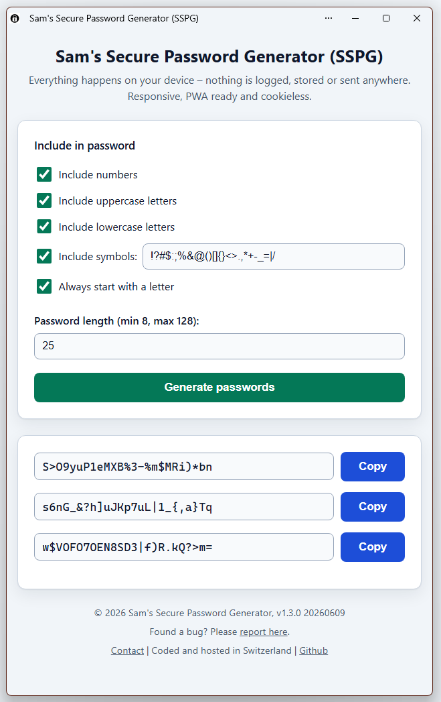
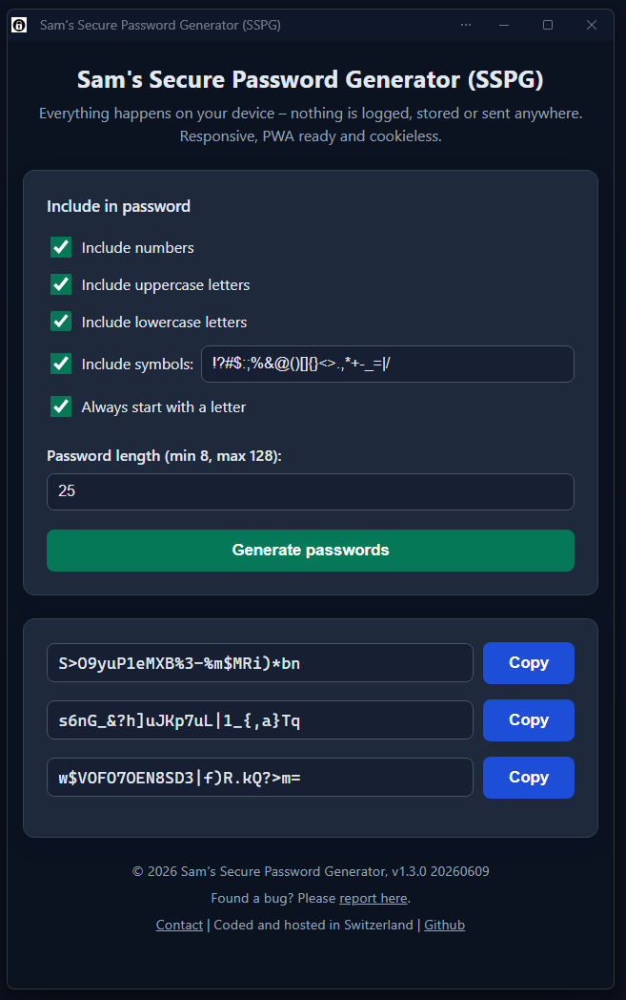

# Sam's Secure Password Generator (SSPG)

My favorite password generator disappeared - so I made my own. 😃 It's available [here](https://sspg.ch) (hosted in Switzerland).

**Everything happens on your device - nothing is logged, stored or sent anywhere.** The app is responsive, PWA ready and cookieless.

Ideas or bugs? [Submit an issue](https://github.com/samuelT2/sams-secure-password-generator/issues/new/choose).




## How it works

- Passwords are generated **entirely client-side** using the browser's CSPRNG
  (`window.crypto.getRandomValues`), with rejection sampling to avoid modulo bias.
- You choose which character types to include (numbers, uppercase, lowercase,
  custom symbols), the length (8–128), and whether the password must start with a
  letter. Each selected type is guaranteed to appear at least once.
- Three suggestions are generated at a time, each with its own copy button.
- No passwords are stored, logged or transmitted. There are no cookies, no
  analytics and no third-party / CDN requests.

## Privacy & security

- **No network calls** beyond loading the static app assets from the same origin.
- A strict **Content-Security-Policy** (`default-src 'self'`, no inline scripts or
  styles) limits what the page is allowed to load.
- Generated passwords live only in the page's input fields; copying uses the
  Clipboard API. Nothing is persisted.

## Languages

- English at `/` ([`index.html`](index.html), canonical and `x-default`), German at
  `/de/` ([`de/index.html`](de/index.html), de-CH). Both pages link each other via
  `hreflang` and the language switcher; keep their markup in sync.
- Texts created in JavaScript (error and copy messages) live in `MESSAGES` in
  [`js/sspg.js`](js/sspg.js); the script picks the language from `<html lang>`.
- Comfort redirect ([`.htaccess`](.htaccess)): browsers whose preferred language is
  German are sent from `/` to `/de/` with a 302 (`Vary: Accept-Language`). Crawlers
  stay on English, and `/?lang=en` (language switcher) skips the redirect. Once the
  service worker is installed, it answers `/` from its cache, so the redirect only
  applies to visits without an active service worker.

## SEO

- Canonical, `hreflang`, Open Graph/Twitter tags and a `WebApplication` JSON-LD block
  in the `<head>` of both pages; social preview image [`assets/og-image.jpg`](assets/og-image.jpg)
  (1200×630).
- [`sitemap.xml`](sitemap.xml) lists both language versions - update `lastmod` when
  the content changes.
- [`404.html`](404.html) (bilingual, `noindex`) is served via `ErrorDocument 404`.

## Offline / PWA

- A service worker ([`sw.js`](sw.js)) caches the app shell (both language versions)
  for offline use.
- Bump `CACHE_NAME` together with the `?v=` query strings in
  [`index.html`](index.html), [`de/index.html`](de/index.html) and [`404.html`](404.html)
  whenever assets change, so clients pick up updates.
- Icons: [`favicon.ico`](favicon.ico) (16/32/48 px) in the root, plus in
  [`assets/favicon/`](assets/favicon/) `favicon-96x96.png`, `apple-icon-180x180.png` and the
  manifest icons `android-icon-192x192.png` / `android-icon-512x512.png` (also precached by the
  service worker). `app.png` and `app_dark.png` are the manifest screenshots - keep their
  `sizes` in [`manifest.json`](assets/pwa/manifest.json) in sync with the real image size.

## Local development

Service workers and the Clipboard API require a secure context, so serve the
folder over `http://localhost` (or HTTPS) rather than opening `index.html` via
`file://`. For example:

```bash
python -m http.server 8080
# then open http://localhost:8080
```

## Tech

Vanilla HTML, CSS and JavaScript - no frameworks, no build step, no dependencies.

## License

See [LICENSE](LICENSE).
